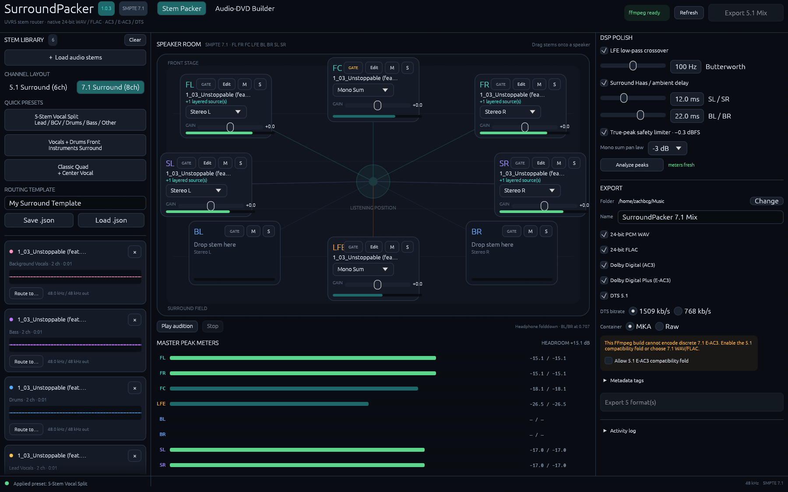
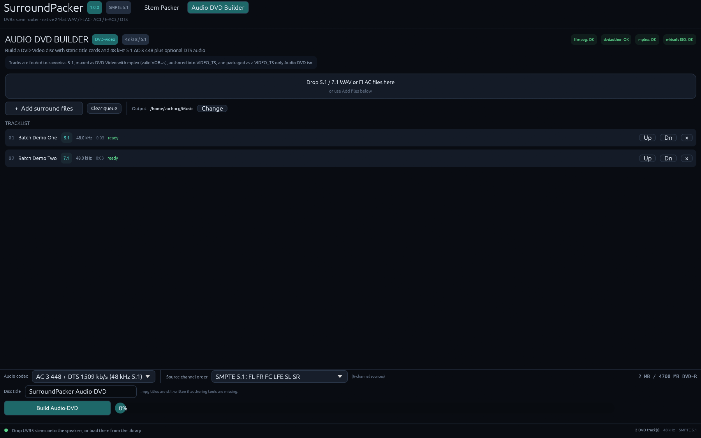

# SurroundPacker

**SurroundPacker** is a fast, native 5.1/7.1 surround stem router for UVR5 audio stems. Drag vocal, drum, bass, instrumental, and melodic stems onto a visual speaker room, shape the mix with an LFE crossover, Haas surround delays, and a true-peak safety limiter, then export a Plex/AVR-ready surround master. A second workspace builds Audio-DVDs with static title cards, 48 kHz 5.1 AC-3 448 plus optional DTS audio, VIDEO_TS, and an optional ISO.

Built in pure Rust with `eframe`/`egui`. Native 24-bit WAV and FLAC export need **no external tools**. AC3, E-AC3, and DTS use the system `ffmpeg`. Audio-DVD authoring uses `ffmpeg`, `mplex` (mjpegtools), `dvdauthor`, and an ISO tool (`xorriso`, `mkisofs`, or `genisoimage`).



*7.1 speaker room with independent surround and back delays, live stereo audition, and the E-AC3 capability notice.*



*Audio-DVD Builder with codec selection, track reordering, and a pinned build footer.*

## Features

- **5.1 / 7.1 layout toggle**, persisted in routing templates.
- **Visual SMPTE speaker rooms**:
  - 5.1: `FL, FR, FC, LFE, SL, SR`
  - 7.1: `FL, FR, FC, LFE, BL, BR, SL, SR`
- **Drag-and-drop routing** from OS file drops, the internal stem library, or per-speaker Browse dialogs.
- **Stereo stem extraction** with `Stereo L`, `Stereo R`, `Mono Sum`, `Left Only`, and `Right Only` modes.
- **Mono-sum pan law** selectable between `-3 dB` and `-6 dB`.
- **Layered speaker channels** so presets can combine, for example, drums and subtle vocals in the front pair.
- **Independent per-channel gain, mute, and solo** plus per-layer trim and mute.
- **Per-speaker noise gate** for UVR5 stem bleed, with adjustable threshold (`-60` to `-15 dB`, default `-32 dB`) and release (`50` to `600 ms`, default `250 ms`), a fast 4 ms attack, and a 150 ms hold.
- **UVR5 filename auto-routing presets**:
  - *5-Stem Vocal Split* (Lead Vocals → FC, Background Vocals → SL/SR, Drums → FL/FR, Other → FL/FR + SL/SR, Bass → LFE)
  - *Vocals + Drums Front / Instruments Surround*
  - *Classic Quad + Center Vocal*
- **Automatic Vocal Split detection** on import: a complete 5/6-stem UVR5 set applies the Vocal Split preset, ignoring a redundant combined `(Vocals)` file
- **Trailing-tag role detection** so titles containing `(feat. Artist)` or other parenthetical metadata do not override the final UVR5 role tag
- **Routing templates** saved and loaded as human-readable `.json` files.
- **LFE low-pass crossover** (80–120 Hz, default 100 Hz, 2nd-order Butterworth).
- **Dual surround Haas delays** (0–35 ms):
  - `SL`/`SR`: 15 ms in 5.1, 12 ms in 7.1
  - `BL`/`BR`: 22 ms in 7.1
- **Live stereo headphone audition** using `cpal`, with 7.1 `BL`/`BR` folded into L/R at `0.707`.
- **True-peak safety limiter** at −0.3 dBFS with linked true-peak trim and pre/post dBFS meters.
- **Five export formats from one mix**:
  1. 24-bit PCM WAV (`WAVEFORMATEXTENSIBLE`, 6 or 8 channels)
  2. 24-bit FLAC (native Rust encoder, 6 or 8 channels, channel-mask metadata, tags)
  3. Dolby Digital AC3 at 640 kb/s (5.1)
  4. Dolby Digital Plus E-AC3 at 640 kb/s (5.1) or 768 kb/s (7.1 where supported)
  5. DTS Coherent Acoustics at 1509/768 kb/s (5.1)
- **Batch or single-format export** with live progress and an activity log.
- **Audio-DVD Builder tab** with a reorderable queue, 5.1/7.1 detection, automatic folddown/resampling, source channel-order remapping, AC-3 448 with optional DTS 1509/768, title cards, valid DVD VOBUs, VIDEO_TS authoring, and ISO packaging.
- **ffmpeg status badge** at startup plus a Refresh button.

All exports use locked SMPTE order:

```text
5.1: FL, FR, FC, LFE, SL, SR
7.1: FL, FR, FC, LFE, BL, BR, SL, SR
```

## Screens

The central room is the routing surface. Each speaker card accepts a stem and shows its filename, channel mode, channel trim, mute/solo state, noise-gate control, and peak meter. The left panel holds the stem library, presets, and templates. The right panel contains DSP, export settings, and progress.

The **Edit** button on a speaker opens the layer editor for combining multiple stems in one channel.

### Speaker noise gate

Each speaker card has a **GATE** pill. Open it to enable the gate and adjust its threshold and release. The gate is applied to the summed signal of that speaker, so layered sources share one gate.

- **Detector**: RMS/peak hybrid that follows both consonants and sustained vocals.
- **Attack**: 4 ms, so the first consonant is not clipped.
- **Hold**: 150 ms after the signal falls below the threshold.
- **Release**: exponential, adjustable from 50 to 600 ms (default 250 ms). The tail reaches roughly −43 dB at `release_ms`, then silence.

The pill text turns accent-colored when enabled and warning-colored while the gate is actively attenuating. Gate settings are saved with routing templates and applied identically in the live stereo audition and every exported file.

## Build

### Requirements

- Rust 1.85 or newer
- Linux: an X11/OpenGL session (XWayland works)
- Windows: MSVC target
- Optional: `ffmpeg` on `PATH` for AC3/E-AC3/DTS and Audio-DVD title encoding
- Required for Audio-DVD authoring: `mplex` (mjpegtools) to create DVD NAV/VOBU packs
- Optional: `dvdauthor` for VIDEO_TS authoring
- Optional: `xorriso`, `mkisofs`, or `genisoimage` for `.iso` packaging
- Audio output device for the headphone audition (`cpal`: ALSA on Linux, WASAPI on Windows)

### Linux release build

```bash
cargo build --release
./target/release/surround-packer
```

### Windows MSVC cross-build

The project is configured for static CRT linking in `.cargo/config.toml`:

```toml
[target.x86_64-pc-windows-msvc]
rustflags = ["-C", "target-feature=+crt-static"]
```

This produces a `surround-packer.exe` that runs on a clean Windows install without the VC++ Redistributable.

Install the target and `cargo-xwin`, then build:

```bash
rustup target add x86_64-pc-windows-msvc
cargo install cargo-xwin
cargo xwin build --release --target x86_64-pc-windows-msvc
```

The executable is written to:

```text
target/x86_64-pc-windows-msvc/release/surround-packer.exe
```

`cargo-xwin` downloads the Microsoft CRT/SDK headers and libraries and links with `lld-link`; no Visual Studio installation is required.

### Linux AppImage

Install `appimagetool`, then build the AppImage from the release binary:

```bash
cargo build --release
./scripts/build-appimage.sh
```

The result is:

```text
dist/SurroundPacker-1.0.3-x86_64.AppImage
```

The AppImage bundles the executable, icon, desktop entry, license, and third-party notices. It requires the glibc version of the build host (2.43 or newer for the current CachyOS-built release); external media tools such as `ffmpeg`, `mplex`, `dvdauthor`, and an ISO tool remain system dependencies.

## Usage

1. **Choose 5.1 or 7.1** in the Channel Layout control.
2. **Load stems** with *Load audio stems*, or drop `.wav`, `.flac`, `.mp3`, or `.ogg` files anywhere on the app.
3. **Route stems** by dragging a library card onto a speaker. You can also use *Route to…* on the card or the Browse control inside a speaker.
4. **Apply a preset** or build the mix manually. Dropping a stem onto a speaker that already has sources adds another layer.
5. **Shape the mix** with LFE crossover, surround delays, pan law, and the limiter.
6. **Analyze peaks** or let the automatic debounced analysis update the master meters.
7. **Audition** the stereo headphone folddown, then **choose formats**, output folder, base name, container, and metadata, and press **Export**.

### Audio-DVD Builder

The second top-level tab builds a DVD-Video disc from existing 5.1/7.1 files:

1. Drop or multi-select 5.1/7.1 `.wav`/`.flac` tracks.
2. Inspect detected layout and sample rate; reorder with Up/Dn/Remove.
3. Select the source channel order if an older file uses Film/DTS order.
4. Choose the audio codec:
   - AC-3 448 + DTS 1509 kb/s (default)
   - AC-3 448 + DTS 768 kb/s
   - AC-3 448 kb/s only
   
   AC-3 is always stream 0 so every NTSC DVD player can play the disc; DTS is stream 1 for players that support it.
5. Set the disc title and output folder.
6. Press **Build Audio-DVD**.

Each track is decoded, folded to canonical 5.1, resampled to 48 kHz, limited, and muxed with a 720×480 static title card. The title is encoded as an MPEG-2 video elementary stream plus AC-3 and optional DTS audio, then multiplexed with `mplex -f 8` to produce DVD NAV packs and 0.4–1.0 s VOBUs. The builder writes `dvdauthor.xml`, authors `VIDEO_TS`, and packages a `VIDEO_TS`-only `Audio-DVD.iso` when the tools exist. If `mplex` is missing the `.mpg` titles are still produced, but authoring is skipped because a disc without NAV packs will stutter on hardware players.

The three FFmpeg passes keep the video graph single-input and filter-free, which sidesteps an FFmpeg 9 filtergraph scheduler deadlock that can freeze `-t` jobs. A 20-second stall watchdog kills and retries FFmpeg if it stops reporting progress. An in-progress build can be cancelled from the footer; closing the window also terminates FFmpeg instead of leaving an orphan process.

The footer stays pinned with the codec selector, estimated disc size (`MB / 4700 MB DVD-R`), Build button, Cancel button, and progress bar, so large queues scroll without hiding the export control.

Stems are decoded in the background and resampled to **48 kHz** with a windowed-sinc resampler. Shorter stems are zero-padded to the longest source.

### Optional command line

You can preload stems, layout, and presets at startup:

```bash
surround-packer --layout 7.1 --preset vocals-drums "Song_(Vocals).flac" "Song_(Drums).flac"
surround-packer --tab dvd "Album Track 01.wav" "Album Track 02.flac"
```

Preset names: `vocal-split` / `5-stem`, `vocals-drums` / `front`, `quad` / `classic-quad`. Layouts: `5.1`, `7.1`. Tabs: `stem`, `dvd`.

## Format details

### 24-bit WAVEFORMATEXTENSIBLE WAV

- 6 or 8 channels at the project sample rate (48 kHz)
- 24 valid bits in a 24-bit container
- `wFormatTag = 0xFFFE`
- 5.1: `dwChannelMask = 0x003F` (`FL | FR | FC | LFE | SL | SR`)
- 7.1: `dwChannelMask = 0x063F` (`FL | FR | FC | LFE | BL | BR | SL | SR`)
- PCM SubFormat GUID `00000001-0000-0010-8000-00AA00389B71`
- Sample interleaving is locked SMPTE order

### 24-bit FLAC

`flacenc` writes the lossless stream natively at 6 or 8 channels. SurroundPacker adds a Vorbis-comment metadata block containing:

```text
WAVEFORMATEXTENSIBLE_CHANNEL_MASK=0x003F   # 5.1
WAVEFORMATEXTENSIBLE_CHANNEL_MASK=0x063F   # 7.1
ARTIST=...
TITLE=...
ALBUM=...
ENCODER=SurroundPacker 1.0.3
```

The mask comment is the standard FLAC convention for signaling the 5.1 speaker layout because FLAC's stream header has no channel-mask field.

### AC3 / E-AC3 / DTS / legacy folddown

FFmpeg never guesses or remaps the 5.1 layout. SurroundPacker writes a `WAVEFORMATEXTENSIBLE` master with an explicit speaker mask and feeds that WAV directly into FFmpeg. No `pan`, `channelmap`, or `-channel_layout` filter is used, so channels cannot be double-permuted.

- 5.1 master: mask `0x003F`, order `FL, FR, FC, LFE, SL, SR`
- 7.1 master: mask `0x063F`, order `FL, FR, FC, LFE, BL, BR, SL, SR`
- AC3: `-c:a ac3 -b:a 640k`
- E-AC3 5.1: `-c:a eac3 -b:a 640k`
- E-AC3 7.1: `-c:a eac3 -b:a 768k`
- DTS: `-strict -2 -c:a dca -b:a 1509k` or `768k`

Default output is Matroska (`.mka`), which is the most reliable Plex/AVR container for raw compressed audio. A **Raw** option produces `.ac3`, `.eac3`, or `.dts`.

**5.1-only formats:** AC3 and standard DTS never accept 8-channel input. In 7.1 mode they automatically use a 5.1 folddown bus:

```text
SL = SL + 0.707 * BL
SR = SR + 0.707 * BR
```

**7.1 E-AC3:** the master is a direct 8-channel `0x63F` WAV encoded at 768 kb/s. Some FFmpeg builds (including the native FFmpeg 9 encoder) advertise only 5.1 E-AC3. SurroundPacker probes the encoder and, when 7.1 is unavailable, disables 7.1 E-AC3 by default. The Export panel offers an explicit **Allow 5.1 E-AC3 compatibility fold** option; when enabled, it writes a labeled 5.1 compatibility file rather than silently mislabeling a 5.1 stream as 7.1.

### Audio-DVD (DVD-Video)

Audio-DVD titles are generated as 720×480 NTSC MPEG-2:

- 1 fps static title-card source, muxed to compliant 29.97 fps DVD video by `-target ntsc-dvd`
- `Track XX - Title`
- `48 kHz 5.1 AC-3 448` as stream 0, plus optional `DTS 1509/768` as stream 1
- Audio source is the direct 6-channel `WAVEFORMATEXTENSIBLE` master with mask `0x003F`; no pan/channelmap filters
- AC-3: `-c:a ac3 -b:a 448k` (DVD-Video maximum)
- DTS: `-strict -2 -c:a dca -b:a 1509k|768k`
- `-target ntsc-dvd` for the video elementary stream
- `mplex -f 8 -o <track>.mpg <video>.m2v <audio>.ac3 [<audio>.dts]` creates the required NAV packs and 0.6 s VOBUs
- `dvdauthor -o iso_root -x dvdauthor.xml` writes `iso_root/VIDEO_TS`
- ISO: `xorriso -as mkisofs -dvd-video`, `mkisofs -dvd-video`, or `genisoimage -dvd-video` against `iso_root` only

Output layout:

```text
<output>/Audio-DVD/
  01 - Track.mpg          (includes NAV packs and dual audio)
  02 - Track.mpg
  dvdauthor.xml
  iso_root/
    VIDEO_TS/
<output>/Audio-DVD.iso   (contains only AUDIO_TS/VIDEO_TS)
```

The ISO is built from `iso_root`, so it contains only the disc files instead of duplicating every intermediate `.mpg`. The build footer reports estimated disc size against a 4,700 MB DVD-R. If `mplex` is missing, authoring is skipped; if `dvdauthor` is missing, the `.mpg` titles remain available; if the ISO tool is missing, the `VIDEO_TS` folder remains available.

## Verification

```bash
cargo fmt --check
cargo clippy --all-targets -- -D warnings
cargo test
cargo build --release
cargo xwin build --release --target x86_64-pc-windows-msvc
```

The test suite covers:

- 24-bit `WAVEFORMATEXTENSIBLE` header generation, mask `0x3F`, and SMPTE interleaving
- 5.1 and 7.1 `WAVEFORMATEXTENSIBLE` headers (`0x3F`/`0x63F`) and SMPTE interleaving
- direct-WAV AC3, E-AC3, and DTS FFmpeg argument generation with no layout filters
- 7.1 -> 5.1 folddown at `0.707`, including legacy AC3/DTS export
- six-channel isolation through WAV, FLAC, AC3, E-AC3, raw DTS, DTS `.mka`, and both audio streams of Audio-DVD titles with FL=440, FR=550, FC=660, LFE=80, SL=880, SR=1100 Hz
- eight-channel 7.1 isolation through WAV/FLAC and 7.1 -> 5.1 folddown through AC3/DTS, including the folded BL/BR tones in SL/SR
- Audio-DVD ISO-tree inspection and dual AC-3 + DTS extraction when `isoinfo` is available
- render-level surround/back delay and limiter activation checks
- DVD codec arguments, `mplex -f 8` NAV/VOBU density, dual AC-3 + DTS streams, `dvdauthor.xml`, estimated disc size, VIDEO_TS authoring, and VIDEO_TS-only ISO packaging
- Film/DTS 5.1 -> SMPTE source-order remapping
- LFE low-pass attenuation above 120 Hz
- the exact 720-sample (15 ms at 48 kHz) surround delay offset
- UVR5 filename routing for `antonymph_(Vocals).flac` and `antonymph_(Drums).flac`, including Lead/Background Vocal Split detection
- five- and six-stem Vocal Split routing, FC gate defaults, and redundant combined-Vocals suppression
- 7.1 presets: lead instruments -> SL/SR, pads/backing/strings -> BL/BR
- stereo audition folddown, including BL/BR at `0.707`
- Audio-DVD multi-track MPEG muxing and queue handling
- mono-sum `-3 dB` / `-6 dB` scaling, limiter ceiling, and template JSON round-trips
- per-slot noise-gate defaults (`-32 dB` / `250 ms`), threshold and release behavior, activity reporting, render integration, and template persistence
- native WAV/FLAC round-trips and real ffmpeg codec output with `ffprobe` when available
- 24-bit 5.1 FLAC compression below 8 MB for a 10-second file, with bit-exact decode and audio-MD5 verification
- noise-to-silence FLAC transition blocks, covering the upstream encoder overflow regression

The integration test skips ffmpeg-specific assertions automatically when `ffmpeg` is not installed.

## Notes

- Peak analysis and export render the mix in the background; the UI remains responsive.
- FLAC encoding buffers the full 24-bit interleaved stream. Long 5.1 mixes use more memory during FLAC export than during WAV export.
- The stereo headphone audition is a folddown monitor, not a full surround playback engine. It is inactive until explicitly started and gracefully reports missing audio devices.
- 7.1 E-AC3 depends on the installed FFmpeg encoder; 7.1 WAV/FLAC are the guaranteed discrete paths.
- Audio-DVD titles are always 48 kHz 5.1 and use a direct WAVEFORMATEXTENSIBLE master; no FFmpeg channel remapping filters are applied.
- AC-3 uses the DVD-Video maximum of 448 kb/s. DTS uses the legal DVD full/half rates (1509.75/754.5 kb/s nominal, reported by FFmpeg as 1536/768).
- Discs must be muxed with `mplex -f 8`. FFmpeg's `-f dvd` stream has no NAV packs, and authoring it directly produces one giant VOBU per track, which causes audio dropouts on hardware players.
- Linux requires the usual X11/OpenGL runtime libraries. Windows builds use the static CRT and have no VC++ Redistributable dependency.

## License

MIT © 2026 SurroundPacker contributors. See [LICENSE](LICENSE) and [THIRD_PARTY_NOTICES.md](THIRD_PARTY_NOTICES.md) for third-party crates, embedded font licenses, and external tool notices. Full third-party license texts are in [`LICENSES/`](LICENSES/).
